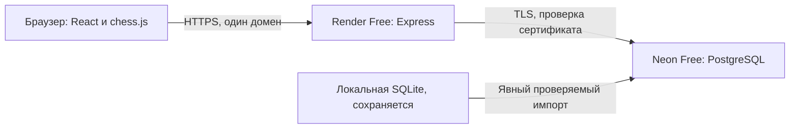

# Архитектура этапа 1: бюджет $0

## Размещение

По последнему решению владельца: **Render Free + Neon Free**. Sites, Workers и D1 не используются. Черновые изменения Workers не включены в проект. Сохранены React, TypeScript, chess.js и Express. Не добавляются платные ресурсы, API или автоматическое изменение тарифов.

## Хранение

`server/storage.ts` реализует общий асинхронный интерфейс для `node:sqlite` и `pg`. Маршруты, проверка шахматных правил и авторизация общие. Переход на PostgreSQL не дублирует приложение и не требует другого клиента. На Render SQLite запрещена, локально сохранена для разработки.

`migrations/001_foundation.sql` поддерживает обе базы. Версии учитываются в `schema_migrations`. Миграции выполняются в транзакции; в PostgreSQL дополнительно используется транзакционная advisory-блокировка, чтобы два процесса не применили одну миграцию одновременно.

Сущности первого этапа: `users`, `sessions`, `board_states`, `auth_attempts`. Сеансы и ограничения входа сохраняются между остановками приложения. ID пользователя связан с каждой личной записью. Единственность владельца гарантирована индексом базы. Многопользовательской регистрации пока нет.

## Безопасность

- scrypt-хеши существующих паролей совместимы между SQLite и PostgreSQL.
- Cookie: HttpOnly, SameSite=Strict, на Render принудительно Secure.
- Публичная регистрация на Render закрыта. Начальный владелец создаётся из защищённых переменных окружения, до обслуживания запросов. Если профиль уже есть, он не перезаписывается.
- Запись выполняется только через авторизованный API, с проверкой origin и версии доски. SQL параметризован, клиент не может записать произвольный FEN.
- В удалённом PostgreSQL TLS с проверкой сертификата и имени сервера; параметры URL не могут отключить SSL. Исключение разрешено только для локальных тестов с loopback, вне Render.
- В журнал не выводятся строки подключения, SQL, пароли и содержимое личных записей.
- Секреты и данные не попадают в `dist/`, Git или клиентский код.

## Стоимость и сон

`render.yaml` описывает один Node-веб-сервис с `plan: free`, без диска, базы Render, масштабирования и автоматического развёртывания. Neon настраивается вручную только на Free. Код не имеет средств повышения тарифов или приобретения ресурсов.

`/api/health` проверяет сам процесс без обращения к базе. `/api/ready` — отдельная ручная проверка PostgreSQL. Пул: максимум 2 соединения, минимум 0, отключение простоя через 10 секунд. В приложении нет фоновых keepalive-запросов, расписаний или опроса рейтинга. Это позволяет Neon засыпать.

## Перенос

`scripts/import-sqlite.ts` делает согласованный read-only снимок пользователя, доски и сеансов, проверяет PGN/FEN, затем переносит данные в пустую PostgreSQL в одной транзакции. Перед коммитом сравнивает все поля, включая хеш пароля и заметки. Непустая цель не перезаписывается, источник не удаляется. Неподдерживаемые PostgreSQL значения приводят к явному отказу без тихой потери данных. Не следует писать в старую SQLite после начала перехода: последующие локальные изменения не синхронизируются с Neon.

## API

Сохранены `/api/auth`, `/api/setup` (только локально), `/api/login`, `/api/logout`, `/api/profile`, `/api/board`. Добавлены отдельная готовность `/api/ready` и начальная настройка из переменных. `GET /api/board` возвращает прежнюю структуру. `POST /api/board` поддерживает `move`, `undo`, `reset`, `notes` с обязательной `revision`. Ошибки сети/базы — по-русски, без временного хранилища взамен недоступной PostgreSQL.

## Границы этапа

Сохранены доска, специальные ходы, нотация, просмотр истории, заметки, вход и исходный дизайн. Стартовый рейтинг не выдаётся за текущий. Другие страницы честно показывают ещё не подключённые возможности.

Chess.com, Stockfish, тренажёры, персональный план и еженедельный отчёт пока не реализованы. Требования полного ТЗ сохраняются. Будущий Stockfish работает в браузере только по кнопке; Chess.com — публичный бесплатный API; тренер — алгоритмические русские рекомендации, пока нет доступной бесплатной языковой модели. Эти функции не имитируются.

Текущая проверка PostgreSQL локальная, облачные Render/Neon требуют отдельного подключения и проверки по инструкции. Публикация не выполнена.
