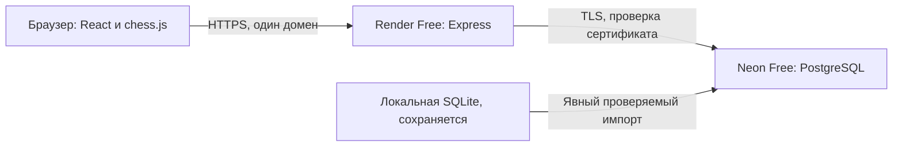

# Архитектура этапов 1–2: бюджет $0

## Размещение

По последнему решению владельца: **Render Free + Neon Free**. Sites, Workers и D1 не используются. Черновые изменения Workers не включены в проект. Сохранены React, TypeScript, chess.js и Express. Не добавляются платные ресурсы, API или автоматическое изменение тарифов.

## Хранение

`server/storage.ts` реализует общий асинхронный интерфейс для `node:sqlite` и `pg`. Маршруты, проверка шахматных правил и авторизация общие. Переход на PostgreSQL не дублирует приложение и не требует другого клиента. На Render SQLite запрещена, локально сохранена для разработки.

`migrations/001_foundation.sql` поддерживает обе базы. Версии учитываются в `schema_migrations`. Миграции выполняются в транзакции; в PostgreSQL дополнительно используется транзакционная advisory-блокировка, чтобы два процесса не применили одну миграцию одновременно.

Сущности первого этапа: `users`, `sessions`, `board_states`, `auth_attempts`. Сеансы и ограничения входа сохраняются между остановками приложения. ID пользователя связан с каждой личной записью. Единственность владельца гарантирована индексом базы. Многопользовательской регистрации пока нет.

## Безопасность

- scrypt-хеши существующих паролей совместимы между SQLite и PostgreSQL.
- Cookie: HttpOnly, SameSite=Strict, на Render принудительно Secure.
- Публичная регистрация на Render закрыта. Начальный владелец создаётся из защищённых переменных окружения, до обслуживания запросов. Если профиль уже есть, он не перезаписывается.
- Запись выполняется только через авторизованный API, с проверкой origin и версии доски. SQL параметризован, клиент не может записать произвольный FEN.
- В удалённом PostgreSQL TLS с проверкой сертификата и имени сервера; параметры URL не могут отключить SSL. Исключение разрешено только для локальных тестов с loopback, вне Render.
- В журнал не выводятся строки подключения, SQL, пароли и содержимое личных записей.
- Секреты и данные не попадают в `dist/`, Git или клиентский код.

## Стоимость и сон

`render.yaml` описывает один Node-веб-сервис с `plan: free`, без диска, базы Render, масштабирования и автоматического развёртывания. Neon настраивается вручную только на Free. Код не имеет средств повышения тарифов или приобретения ресурсов.

`/api/health` проверяет сам процесс без обращения к базе. `/api/ready` — отдельная ручная проверка PostgreSQL. Пул: максимум 2 соединения, минимум 0, отключение простоя через 10 секунд. В приложении нет фоновых keepalive-запросов, расписаний или опроса рейтинга. Это позволяет Neon засыпать.

## Перенос

`scripts/import-sqlite.ts` делает согласованный read-only снимок пользователя, доски и сеансов, проверяет PGN/FEN, затем переносит данные в пустую PostgreSQL в одной транзакции. Перед коммитом сравнивает все поля, включая хеш пароля и заметки. Непустая цель не перезаписывается, источник не удаляется. Неподдерживаемые PostgreSQL значения приводят к явному отказу без тихой потери данных. Не следует писать в старую SQLite после начала перехода: последующие локальные изменения не синхронизируются с Neon.

## API

Сохранены `/api/auth`, `/api/setup` (только локально), `/api/login`, `/api/logout`, `/api/profile`, `/api/board`. Добавлены отдельная готовность `/api/ready` и начальная настройка из переменных. `GET /api/board` возвращает прежнюю структуру. `POST /api/board` поддерживает `move`, `undo`, `reset`, `notes` с обязательной `revision`. Ошибки сети/базы — по-русски, без временного хранилища взамен недоступной PostgreSQL.

## Chess.com и журнал

Express обращается только к разрешённым путям `https://api.chess.com/pub/player/alexander_gusev`, без пароля Chess.com. Есть таймаут, ограничение размера ответа, последовательные запросы, обработка 429/Retry-After и отказ при перенаправлении. Синхронизация начинается вручную. Каждый следующий запрос обрабатывает один месячный архив; прогресс хранится в `sync_jobs`. Прерванный импорт можно продолжить. Старая завершённая история пропускается, текущий и предыдущий месяцы проверяются повторно. Rapid и Blitz имеют независимые маркеры архивов.

Миграция `002_games.sql` добавляет `chess_accounts`, `games`, `game_analyses`, `archive_sync`, `sync_jobs`. Личные запросы ограничены владельцем. Уникальный ключ `(user_id, source_key)` исключает дубликаты. PGN проверяется chess.js; неподдерживаемые варианты и некорректные записи пропускаются со счётчиком. Дебют показывается только по достоверным заголовкам PGN. Рейтинг профиля берётся из публичной статистики при ручной синхронизации.

Новые API: `GET /api/chess`, `POST /api/chess/sync`, `POST /api/chess/sync/step`, `GET /api/games`, `GET /api/games/:id`, `POST /api/games/:id/analysis`. Список имеет фильтры и пагинацию. Захват задания синхронизации защищён сохраняемой арендой; запись результатов проверяет её актуальность в транзакции.

## Stockfish

Неизменённый `stockfish@19.0.1`, Lite single-thread WASM, исполняется отдельным Web Worker в браузере только после нажатия «Анализировать партию». Нет серверного движка, фонового анализа или внешнего платного API. Однопоточная сборка не требует SharedArrayBuffer и cross-origin isolation. `prepare:engine` копирует JS/WASM/лицензию при сборке; точный исходный код распространяется рядом с движком.

Ограничения: один поток, Hash 16 МБ (не вся память процесса), до глубины 14, 100/250/500 мс на позицию. Передаётся полная история ходов, учитываются повторения. Если короткий поиск не дал подтверждённой пары оценка/PV, допускается один настоящий поиск глубины 1. Ошибка движка не заменяется придуманной оценкой. Остановка, уход со страницы или скрытие вкладки завершают Worker. Завершённый префикс можно сохранить как частичный; он не затирает готовый полный анализ.

Оценки нормализуются к белым. Мат хранится отдельно от сантипешек; график ограничивается ±10 пешками, исходные значения сохраняются. Критические моменты определяются по падению оценки и оценочной вероятности результата; это эвристика, не точность Chess.com. Лучший ход и вариант — реальные UCI-ответы. Объяснения не называют непроверенные тактические мотивы; если причина не установлена, явно пишется нейтральное объяснение. Сервер проверяет структуру анализа, соответствие PGN/FEN и законность вариантов, но повторно движок не запускает.

## Взаимодействие и границы

Рабочая доска первого этапа сохраняет свои ходы и заметки. Доска импортированной партии имеет отдельные локальные варианты, не изменяющие исходный PGN. Мышь, сенсорное перетаскивание, нажатия и клавиатура используют общую проверку правил chess.js. SVG фигур оригинальные. Сохранена палитра Chess Performance; компоновка уплотнена, мобильные панели переключаются вкладками.

Тренажёры, импорт не-стандартных вариантов, движок на сервере и языковая модель не добавлены. Облачные ресурсы и тарифы не создаются и не изменяются. Проверка PostgreSQL локальная; публикацию обновления на существующий Render выполняют по инструкции.
